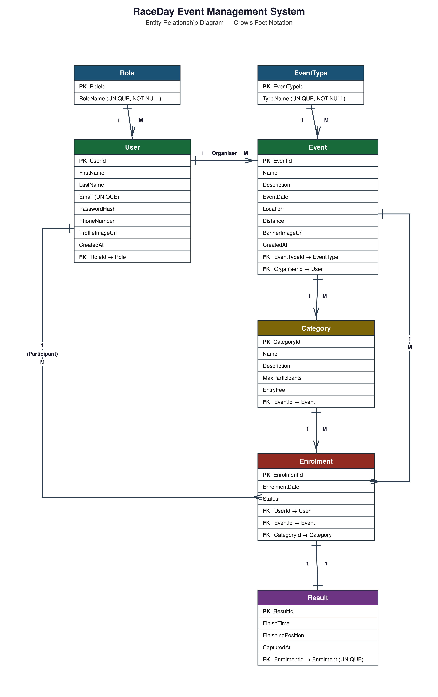
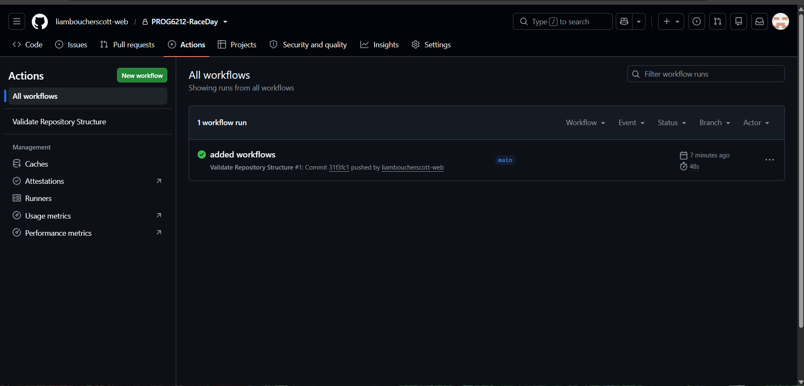

---

## Part 1 — What's in this submission

**ERD** — `docs/ERD.png`
Shows the 7 entities (Role, EventType, User, Event, Category, Enrolment,
Result), their attributes, and every relationship with cardinality.

**API Endpoint Plan** — `docs/api-endpoint-plan.md`
Lists all 28 endpoints across 6 resource groups (Authentication, User
Profile, Events, Categories, Enrolments, Results), including role
restrictions and all success/failure response codes.

**SQL Database Script** — `docs/RaceDayDB.sql`
Creates the full RaceDay database on SQL Server, matching the ERD exactly.
Includes all primary keys, foreign keys, and constraints, plus realistic
seed data (4 users, 3 events, 5 categories, 4 enrolments, 3 results).

---

## How to Run the SQL Script

1. Clone this repository
2. Open `docs/RaceDayDB.sql` in SQL Server Management Studio (SSMS)
3. Connect to any local SQL Server instance (Developer edition works fine)
4. Press **F5** to run the whole script
5. The database `RaceDayDB` will be created and seeded automatically

The script force-drops the database first if it already exists, so it's
safe to re-run as many times as you want.

---

## Entity Relationship Diagram

---

## CI/CD Status

### Note on CI/CD

GitHub Actions is disabled at the organization level on EMGPPT, so the
workflow can't run inside the org repo. The workflow file is still in this
repository at `.github/workflows/validate-docs.yml` and is fully set up to
check that the `/docs` folder contains all the required files.

To prove the workflow runs, I mirrored the repository to my personal
account at
[https://github.com/liamboucherscott-web/PROG6212-RaceDay](https://github.com/liamboucherscott-web/PROG6212-RaceDay)
— the screenshot above shows a successful green build from there.

---

## Video Walkthrough

[Watch the Part 1 video on YouTube](https://youtu.be/bs2I2O4bS6k)

---

## Tools Used

- SQL Server 2025 (Developer edition)
- SQL Server Management Studio (SSMS)
- GitHub for version control
- GitHub Actions for CI/CD
- draw.io for the ERD

---

## Part 2: API Development

### How to run it
1. Open the project in Visual Studio.
2. Make sure the database is set up (just run the SQL script in the `/docs` folder if you haven't yet).
3. Open the terminal and run: `dotnet run --project RaceDay.Api`
4. Go to the Swagger link it gives you (like `https://localhost:xxxx/swagger`) to test everything.

### Roles
- **Organiser:** Can create/edit/delete events, add categories, put in results, and see who enrolled.
- **Participant:** Can look at events, enrol in a category, and check their own results.
*(The API uses sessions to remember who is logged in and stops people from doing things they shouldn't).*

### CI/CD Build
Here's the screenshot of the GitHub Actions build passing:

